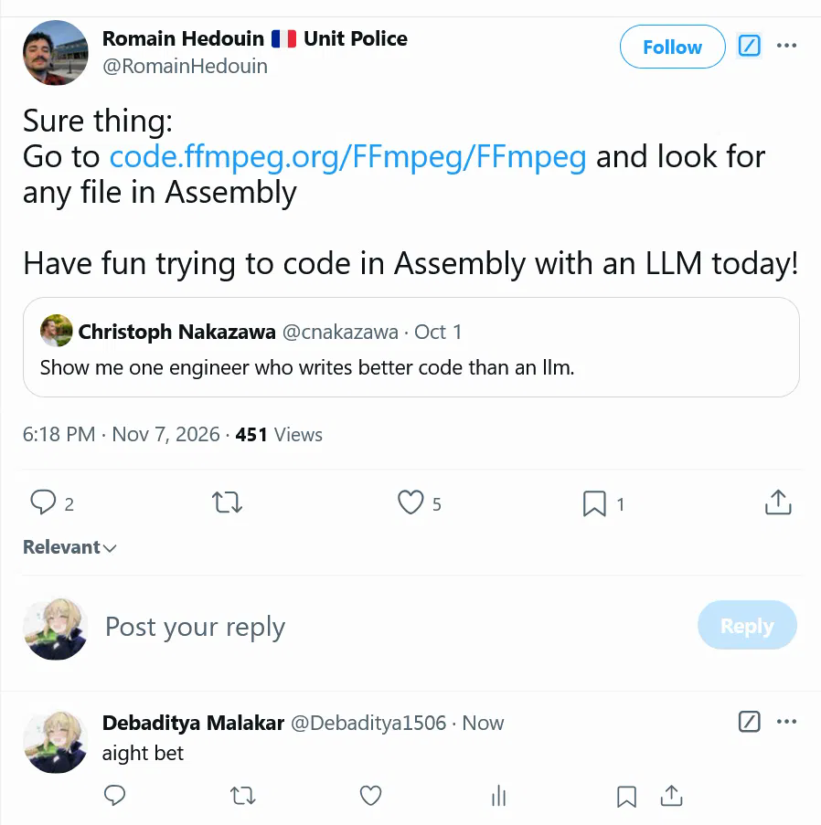
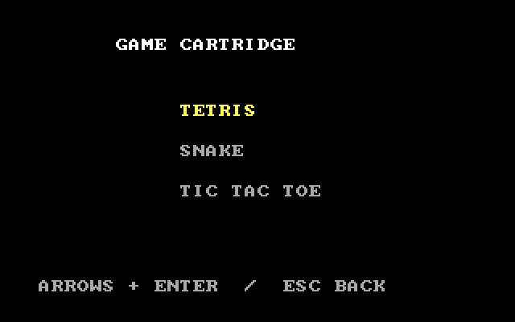
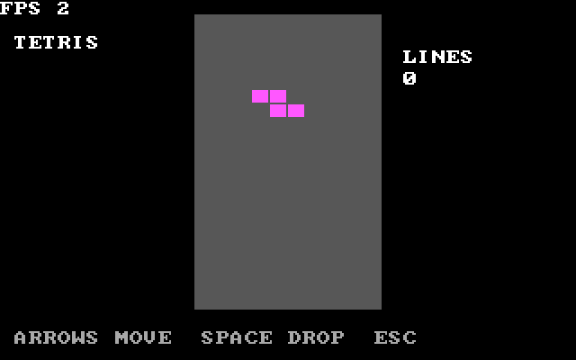
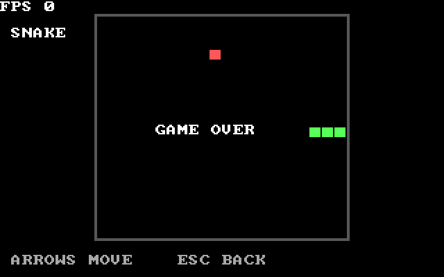
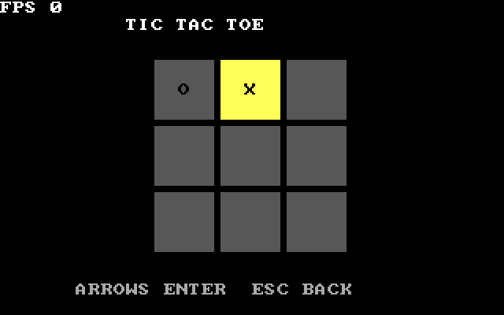

# Game.iso

Three games in a BIOS-bootable x86 cartridge, written in NASM assembly. The build produces both a raw floppy image (`game.img`) and a bootable CD-ROM image (`game.iso`). No operating system, GRUB, C runtime, or BIOS calls in protected mode are used.

The project was sparked by a challenge about writing assembly with an LLM: “aight bet.”



## Screenshots

The selector and games, captured from QEMU:









## Build

Install NASM 2.15 or newer and GNU Make. QEMU is needed to run the image in an emulator. On Debian or Ubuntu:

```sh
sudo apt install nasm make qemu-system-x86
```

From the project directory, build with:

```sh
make
```

On Windows, put NASM and GNU Make on PATH; GNU Make may be named `gmake` or `mingw32-make`:

```powershell
gmake
```

The build uses only NASM and Make on both Windows and Linux. `image.asm` combines the binaries into a 1.44 MB floppy image; `iso.asm` embeds that image in an ISO 9660 filesystem with an El Torito boot catalog. No ISO mastering utility is needed. The default target builds both outputs; use `make game.img` or `make game.iso` to build one explicitly. To rebuild from scratch, run `make clean` followed by `make` (or use the same Make executable name you used to build). The build checks the boot and loader sizes and rejects a main binary larger than the loader can read.

## Run

```sh
qemu-system-i386 -cdrom game.iso -boot d
```

Or boot the raw floppy image:

```sh
qemu-system-i386 -drive format=raw,file=game.img,if=floppy -boot a
```

For the Windows installation used during development:

```powershell
& 'C:\Program Files\qemu\qemu-system-i386.exe' -cdrom game.iso -boot d
```

Use the keyboard to control everything; no mouse is needed. If QEMU captures input, its default release shortcut is Ctrl+Alt+G.

## Controls

| Screen | Controls |
| --- | --- |
| Selector | Up/down to choose, Enter to start, S to shut down QEMU |
| Tetris | Left/right to move, up/Q/X/Z to rotate, F to mirror, down to move down, Space to drop |
| Snake | Arrow keys to steer |
| Tic-Tac-Toe | Arrows to move the cursor, Enter to place X |

R restarts the current game, including after game over; Escape returns to the selector. S on the selector sends QEMU's ACPI power-off request. On machines that do not support that QEMU-specific port, the cartridge halts and displays a message so you can switch power off manually; general physical-hardware ACPI shutdown is not implemented. Tic-Tac-Toe's O uses full-depth minimax with alpha-beta pruning. Tetris displays cleared lines; F mirrors the current piece when there is room. Snake moves at approximately eight cells per second, wraps around screen edges, and ends if it hits itself. Games target 30 redraws per second, while their movement uses separate PIT-timed ticks; the FPS counter reports actual redraws, which may be lower on slower systems.

## Boot and hardware

The BIOS loads a 512-byte boot sector at `0x7c00`. It loads the 512-byte second stage at `0x7e00`; that stage reads up to 64 sectors of game code into `0x8000`, one sector at a time across floppy tracks. It copies the BIOS 8×8 font, sets VGA mode 13h, enables A20, loads a flat GDT, and enters 32-bit protected mode. The games use the linear VGA framebuffer, poll the PS/2 controller and PIT, and run with interrupts disabled. The stack starts at `0x90000`.

The ISO uses El Torito **1.44 MB floppy emulation**, allowing the existing boot sector and loader to read their usual floppy geometry. Its ISO 9660 root also contains the embedded `GAME.IMG`. It targets a legacy BIOS with CD-ROM floppy-emulation support, a VGA adapter, and a PS/2 keyboard interface. Both image formats have been smoke-tested in QEMU on Windows; physical CD drives, real hardware, and UEFI-only machines have not been verified. The ISO is intended for optical media or a virtual CD drive, not as a hybrid USB image. Raw USB boot behavior depends on the BIOS and its disk geometry, so the floppy image should not be assumed to boot as a USB hard disk.

## License

The project is released under the [Unlicense](LICENSE).
